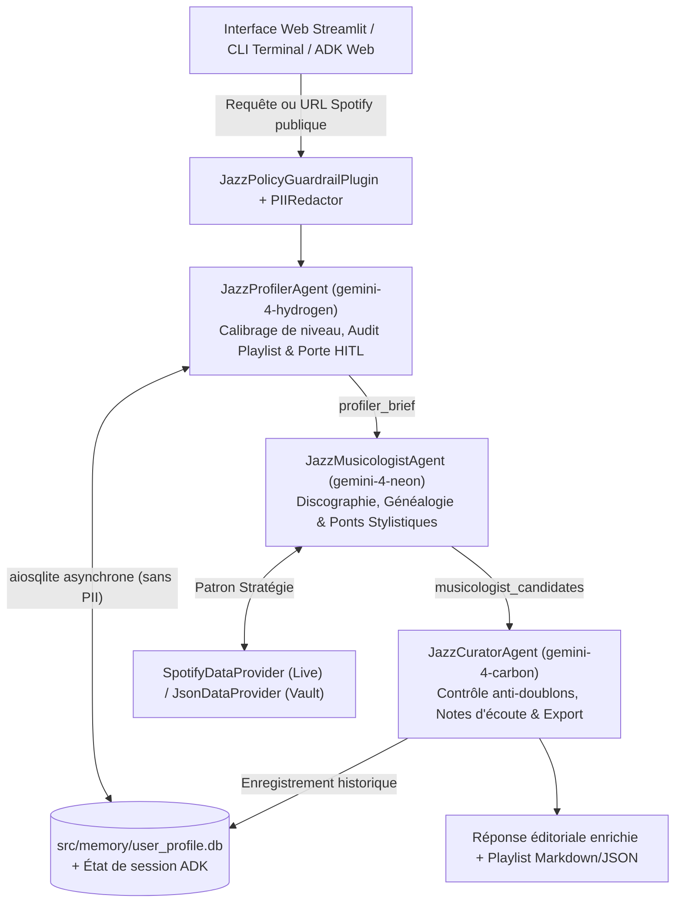

[🇬🇧 Read the documentation in English (README.md)](./README.md) | 🇫🇷 Français

# 🎷 Jazz Concierge (`MilesAgent`)

[](./pyproject.toml)
[](./src/agent.py)
[-8E75B2)](./src/config/settings.py)
[](./src/telemetry/)
[](./infra/)
[](./.github/workflows/ci.yml)
[](./LICENSE)

**Jazz Concierge (`MilesAgent`)** est un système multi-agents autonome de découverte musicale, de musicologie jazz et de curation de playlists de niveau production, développé avec **Google ADK-Python** (`google-adk`) et la famille de modèles **Gemini 4** sur Vertex AI.

Qu'un auditeur ne connaisse absolument rien au jazz (et écoute au quotidien Pink Floyd, Claude Debussy, Stevie Wonder ou des musiques de film) ou qu'il soit un collectionneur aguerri de pressages post-bop et avant-garde, `MilesAgent` réalise un profilage conversationnel naturel, audite des playlists Spotify publiques pour calculer une **Empreinte Sonore (*Sonic Fingerprint*)**, explore la généalogie musicale de **plus de 119 légendes du jazz**, évite toute recommandation redondante grâce à une mémoire SQLite asynchrone, et exporte des parcours d'écoute en Markdown ou JSON.

> **Contexte du projet & Vibecoding piloté par spécification (*Spec-Driven Development*) :** Conçu comme projet de démonstration de bout en bout dans le cadre d'une certification d'ingénierie d'agents IA, `jazz-concierge` a été intégralement **vibecodé selon une approche Spec-Driven Development avec Google Antigravity et Gemini** à partir de sa spécification autonome [`spec.md`](./spec.md). Toute personne peut consulter [`spec.md`](./spec.md) et régénérer ou auditer l'intégralité du dépôt à l'aide du prompt reproductible figurant en bas de ce document.

---

## ⚡ Fast Test — Démarrage Rapide en 2 Minutes (*Tester l'application immédiatement*)

Suivez ces commandes prêtes à copier-coller pour vérifier et lancer l'application immédiatement :

### 1. Cloner & Installer les dépendances

**Avec `uv` (recommandé) :**
```bash
git clone git@github.com:s-tilly/jazz-concierge.git
cd jazz-concierge
uv venv .venv
source .venv/bin/activate
uv pip install -r requirements.txt
```

**Ou avec `pip` standard :**
```bash
python3 -m venv .venv
source .venv/bin/activate
pip install --upgrade pip && pip install -r requirements.txt
```

### 2. Vérification instantanée sans aucune clé API (Suite 100 % hors-ligne)

Exécutez le linter, le validateur de catalogue (119 artistes jazz, 222 albums, 15 ponts stylistiques), les tests unitaires et le harnais d'évaluation *golden dataset* **sans aucune clé API ni identifiant cloud** :

```bash
ruff check .
python scripts/enrich_vault_from_spotify.py --validate-only
pytest -v
```

### 3. Configuration minimale Gemini (Vertex AI ADC ou clé API)

```bash
cp .env.example .env
# Éditez .env et renseignez GOOGLE_CLOUD_PROJECT=your-gcp-project-id
```

Authentifiez-vous localement via les *Application Default Credentials* (ADC) de Google Cloud (aucun fichier JSON de clé stocké sur le disque) :
```bash
gcloud auth login
gcloud config set project your-gcp-project-id
gcloud auth application-default login
gcloud auth application-default set-quota-project your-gcp-project-id
```
*(Alternativement, définissez `GOOGLE_GENAI_USE_VERTEXAI=FALSE` et `GOOGLE_API_KEY=<votre-cle>` dans `.env`.)*

### 4. Lancer l'application & Tester 3 scénarios prêts à l'emploi

Démarrez l'**interface Web Streamlit** (sur `http://127.0.0.1:8501`) :
```bash
streamlit run src/app.py --server.address=127.0.0.1 --server.port=8501
```
Ou lancez le **CLI interactif dans le terminal** :
```bash
python -m src.cli
```

Testez immédiatement ces 3 scénarios :
1. **Prompt grand débutant (*Beginner*) :** *« Je n'y connais rien au jazz. J'adore Pink Floyd et Claude Debussy : par quels albums chaleureux et mélodiques commencer ? »*
2. **Audit de playlist en 1 clic :** Cliquez sur **« Test Sample »** dans la barre latérale Streamlit (ou tapez `/sample` dans le CLI, ou collez l'URL d'une playlist Spotify publique créée par un utilisateur) pour générer une **Empreinte Sonore (*Sonic Fingerprint*)** multi-genres.
3. **Export de playlist curatée :** Cliquez sur **« Generate Export »** dans la barre latérale (ou tapez `/export markdown` / `/export json` dans le CLI) pour télécharger votre sélection tout en enregistrant les albums dans l'historique SQLite anti-doublons.

---

## 🎯 Guide Complet des Fonctionnalités & Options Configurables

### Fonctionnalités principales
* **Calibrage sur 4 niveaux d'initiation (`beginner` → `novice` → `intermediate` → `connoisseur`) :** Adapte le discours, depuis des passerelles émotionnelles sans jargon théorique pour les néophytes jusqu'à l'analyse musicologique pointue (labels historiques, sidemen, harmonie modale/post-tonale) pour les connaisseurs.
* **Filtrage harmonique et par formation :** Ajuste les sélections selon le profil harmonique (`roots_dixieland`, `standard_swing`, `modal_modern`, `avant_garde`) et la taille d'ensemble (`solo`, `small_ensemble`, `big_band`).
* **Empreinte Sonore par audit de playlist Spotify publique :** Extrait titres, artistes, genres dominants et tempo/énergie estimés afin de calibrer le niveau d'initiation et bâtir des ponts stylistiques vers le jazz.
* **Mémoire asynchrone persistante & historique anti-doublons :** Stocke les préférences nettoyées de toute donnée personnelle (PII) et les albums déjà recommandés via `aiosqlite` (`src/memory/user_profile.db`) pour éviter les répétitions d'une session à l'autre.
* **Confirmation *Human-in-the-Loop* (HITL) avant réinitialisation :** Protège l'effacement définitif du profil (`reset_user_taste_profile`) via `FunctionTool(..., require_confirmation=True)` et une validation explicite dans l'interface Web ou le CLI.
* **Exports partageables :** Génère des guides d'écoute Markdown et des manifestes de playlists JSON prêts à importer.

### Tableau exhaustif des variables d'environnement et valeurs par défaut

Toute la configuration est centralisée dans `.env` (`src/config/settings.py` et `src/config/secrets.py`). Chaque variable possède un comportement par défaut déterministe lorsqu'elle est absente ou vide :

| Variable | Valeurs acceptées | Valeur par défaut exacte / Comportement si vide ou non définie |
|---|---|---|
| `GOOGLE_GENAI_USE_VERTEXAI` | `TRUE` / `FALSE` | **`TRUE`** — Route les appels Gemini via Google Cloud Vertex AI avec ADC. |
| `GOOGLE_CLOUD_PROJECT` | ID de projet GCP | `""` (vide) — Requis lorsque `GOOGLE_GENAI_USE_VERTEXAI=TRUE` (`your-gcp-project-id` dans `.env.example`). |
| `GOOGLE_CLOUD_LOCATION` | `global` ou région GCP | **`global`** — Point de terminaison Vertex AI par défaut exposant les modèles publics Gemini 4. |
| `GOOGLE_API_KEY` | Clé API Gemini | `""` (vide) — Authentification alternative optionnelle si `GOOGLE_GENAI_USE_VERTEXAI=FALSE`. |
| `USE_SECRET_MANAGER` | `TRUE` / `FALSE` | **`FALSE`** — Lit `.env` / les variables d'environnement en local ; à `TRUE`, résout les secrets via Google Cloud Secret Manager avec repli sur `.env`. |
| `GEMINI_MODEL` | ID de modèle Gemini | `""` (vide) — **Routage stratégique par agent préservé** si vide ; si défini, sert de surcharge globale lorsque la variable dédiée d'un agent est vide. |
| `PROFILER_MODEL` | ID de modèle Gemini | **`gemini-4-hydrogen`** — Profilage conversationnel rapide, audit de playlist & déclenchement HITL (`JazzProfilerAgent`). |
| `MUSICOLOGIST_MODEL` | ID de modèle Gemini | **`gemini-4-neon`** — Recherche discographique structurée, généalogie & ponts stylistiques (`JazzMusicologistAgent`). |
| `CURATOR_MODEL` | ID de modèle Gemini | **`gemini-4-carbon`** — Curation éditoriale approfondie, vérification anti-doublons & notes d'écoute (`JazzCuratorAgent`). |
| `SPOTIFY_CLIENT_ID` | Client ID Spotify | `""` (vide) — Optionnel ; active `SpotifyDataProvider` lorsqu'il est associé à `SPOTIFY_CLIENT_SECRET`. |
| `SPOTIFY_CLIENT_SECRET` | Client Secret Spotify | `""` (vide) — Optionnel ; si vide, bascule automatiquement vers `JsonDataProvider` (`data/jazz_vault.json`). |
| `SPOTIFY_API_KEY` | `client_id:client_secret` | `""` (vide) — Raccourci optionnel combinant identifiant et secret en une seule variable. |
| `SPOTIFY_REDIRECT_URI` | URI HTTP loopback | **`http://127.0.0.1:8501/callback`** — URI de redirection loopback déclarée dans le Spotify Developer Dashboard. |
| `SQLITE_DB_PATH` | Chemin de fichier | **`src/memory/user_profile.db`** — Chemin de la base SQLite asynchrone (`/tmp/user_profile.db` en conteneur). |
| `LOG_LEVEL` | `DEBUG`, `INFO`, `WARNING`, `ERROR` | **`INFO`** — Niveau de verbosité des journaux JSON structurés (`jazz_concierge.*`). |
| `OTEL_EXPORTER_GCP_TRACE` | `TRUE` / `FALSE` | **`FALSE`** — Spans OpenTelemetry locaux actifs ; à `TRUE`, exporte les traces vers Google Cloud Trace. |

---

## 🎧 Fonctionnement Avec vs. Sans Clés API Spotify

`jazz-concierge` met en œuvre un **Patron Stratégie Hybride** (`DataProvider`) rendant les clés Spotify **100 % optionnelles** :

| Capacité | Sans clés Spotify (Par défaut — vide / non défini) | Avec clés Spotify (`SPOTIFY_CLIENT_ID` + `SPOTIFY_CLIENT_SECRET`) |
|---|---|---|
| **Provider actif** | `JsonDataProvider` (`src/data_providers/json_provider.py`) | `SpotifyDataProvider` (`src/data_providers/spotify_provider.py`) + repli JSON automatique |
| **Expérience utilisateur** | Zéro erreur, zéro fenêtre OAuth, aucune dégradation UX | Enrichissement live des métadonnées + audit temps réel de playlists publiques |
| **Catalogue Jazz** | Voûte hors-ligne curatée (`data/jazz_vault.json` : **119 artistes, 222 albums, 15 ponts**) | Même voûte musicologique enrichie en direct avec URLs d'écoute Spotify, pochettes et popularité |
| **Audit de Playlist** | Audite `data/sample_playlist.json` (18 titres éclectiques Rock/Soul/Funk/Classique) | Audite toute playlist Spotify publique créée par un utilisateur via *Client Credentials* serveur-à-serveur (avec heuristique genre/durée transparente si Spotify renvoie `403` sur `audio-features`) |

### Guide succinct en 4 étapes pour créer une clé Spotify Developer
1. Rendez-vous sur [https://developer.spotify.com/dashboard](https://developer.spotify.com/dashboard) et cliquez sur **Create app**.
2. Saisissez un nom et une description, ajoutez `http://127.0.0.1:8501/callback` dans **Redirect URIs**, puis cliquez sur **Add** *(important : Spotify refuse désormais `localhost` ; utilisez toujours `127.0.0.1` pour le loopback local)*.
3. Cochez **Web API**, acceptez les conditions d'utilisation et cliquez sur **Save**.
4. Ouvrez **Settings** et copiez le **Client ID** (`SPOTIFY_CLIENT_ID`) ainsi que le **Client Secret** (`SPOTIFY_CLIENT_SECRET`) dans votre fichier `.env`.

---

## 🏗️ Architecture & Orchestration Multi-Agents



### Routage stratégique des modèles Gemini 4
* **`JazzProfilerAgent` (`gemini-4-hydrogen`) :** Profilage conversationnel à faible latence, détection d'URL Spotify (`analyze_playlist`), synchronisation SQLite (`sync_user_taste_profile`) et confirmation *Human-in-the-Loop* (`reset_user_taste_profile`).
* **`JazzMusicologistAgent` (`gemini-4-neon`) :** Recherche discographique filtrée (`search_artist_discography`), navigation généalogique (`trace_artist_lineage`) et passerelles inter-genres (`find_subgenre_bridges`).
* **`JazzCuratorAgent` (`gemini-4-carbon`) :** Rédaction éditoriale nuancée adaptée au niveau de l'auditeur, contrôle anti-doublons face à `listening_history` et génération d'exports (`export_curated_playlist`).

### Les 7 Outils ADK Typés (`src/tools/jazz_tools.py`)

| Outil | Agent responsable | Async | HITL | Responsabilité métier |
|---|---|---|---|---|
| `analyze_playlist` | `JazzProfilerAgent` | Oui | Non | Audite une URL/URI Spotify publique ou `'sample'`, supprime `?si=`, calcule le Sonic Fingerprint et persiste dans SQLite. |
| `sync_user_taste_profile` | `JazzProfilerAgent` / `Curator` | Oui | Non | Met à jour de manière atomique le profil nettoyé de PII (niveau, harmonie, formation, artistes aimés/exclus). |
| `reset_user_taste_profile` | `JazzProfilerAgent` | Oui | **Oui** | Purge les préférences, audits et historiques SQLite derrière `FunctionTool(..., require_confirmation=True)`. |
| `search_artist_discography` | `JazzMusicologistAgent` | Non | Non | Recherche des albums par `group_format`, `era` et `accessibility_level` avec suggestions floues en cas d'erreur. |
| `trace_artist_lineage` | `JazzMusicologistAgent` | Non | Non | Explore `influences`, `collaborators` et `disciples` avec justifications historiques. |
| `find_subgenre_bridges` | `JazzMusicologistAgent` | Non | Non | Relie Rock, Soul, Funk, Debussy, Boulez, Hip-Hop, Ambient, Blues ou Cinéma à des albums passerelles. |
| `export_curated_playlist` | `JazzCuratorAgent` | Oui | Non | Exporte la sélection de session en `markdown` ou `json` et met à jour `listening_history`. |

### Schéma SQLite Asynchrone (`src/memory/sqlite_memory.py`)
Quatre tables relationnelles gérées de manière non bloquante avec `aiosqlite` :
* `users` : `user_id`, `knowledge_level`, `harmonic_preference`, `formation_preference`, `sonic_fingerprint_json`, `compacted_summary`, horodatages.
* `playlist_audits` : `id`, `user_id`, `playlist_ref` (nettoyé de `?si=`), `playlist_name`, `dominant_genres_json`, `estimated_tempo_bpm`, `fingerprint_report_json`.
* `artist_preferences` : clé primaire composite `(user_id, artist_name)` avec `preference_type` (`liked`, `disliked`, `known`).
* `listening_history` : `id`, `user_id`, `album_title`, `artist_name`, `recommended_by_agent`, `user_feedback`, `timestamp`.

### Observabilité, Capture *Intent vs. Outcome* & Rédaction PII Active
* **Journaux JSON structurés (`src/telemetry/logger.py`) :** 100 % des journaux sont émis en JSON structuré (`timestamp`, `level`, `trace_id`, `span_id`, `agent_name`, `model_id`). Chaque outil journalise `event="tool_intent"` avant exécution et `event="tool_outcome"` (statut + `duration_ms`) après exécution.
* **Tracing distribué OpenTelemetry (`src/telemetry/tracer.py`) :** Spans parents/enfants de bout en bout, exportables vers Google Cloud Trace (`OTEL_EXPORTER_GCP_TRACE=TRUE`).
* **`PIIRedactor` (`src/telemetry/pii_redactor.py`) :** Masque activement e-mails, numéros de téléphone, jetons API, numéros d'identité, adresses IPv4 externes et paramètres de pistage `?si=` / `utm_*` avant toute écriture dans les logs ou SQLite.

---

## 🛠️ Workflows Développeur, Maintenance du Catalogue & `agents-cli`

### Commandes ADK & `agents-cli`
`src/agent.py` (ré-exporté dans `src/__init__.py`) expose les objets canoniques `root_agent` et `app` :

```bash
# Inspecter l'environnement ADK / agents-cli
agents-cli info

# Exécuter un tour unique via le CLI Python
python -m src.cli --prompt "Recommande 3 albums de piano jazz solo pour un amateur de Debussy"

# Lancer le playground Web développeur ADK
adk web .
# ou :
agents-cli playground

# Lancer l'évaluation sur la plateforme Gemini (une fois authentifié sur GCP)
agents-cli eval run --config tests/eval/eval_config.yaml --dataset tests/eval/golden_dataset.json
```

### Validation du catalogue & Enrichissement Spotify optionnel
```bash
# Validation 100 % hors-ligne des schémas, quotas (>= 80 artistes) et couvertures (compatible CI)
python scripts/enrich_vault_from_spotify.py --validate-only

# Optionnel : enrichir de façon idempotente les URLs et pochettes Spotify dans data/jazz_vault.json
python scripts/enrich_vault_from_spotify.py --enrich
```

---

## 🚀 Guide Complet de Déploiement en 3 Modes

### Mode 1 — Endpoint Localhost / Docker Privé (`127.0.0.1`)
Construisez l'image conteneur de production et liez le port strictement à l'interface loopback locale (`127.0.0.1:8080`) sans exposition réseau externe :

```bash
docker build -t jazz-concierge:local .

docker run --rm -it \
  -p 127.0.0.1:8080:8080 \
  --env-file .env \
  -v ~/.config/gcloud:/home/appuser/.config/gcloud:ro \
  jazz-concierge:local
```
Ouvrez ensuite `http://127.0.0.1:8080` dans votre navigateur.

### Mode 2 — Déploiement Cloud Run Privé restreint par IAM (avec Proxy HTTPS)
Conçu pour les organisations Google Cloud appliquant le **Domain Restricted Sharing** (où `allUsers` est interdit). `infra/variables.tf` définit `allow_public_access = false` par défaut :

```bash
# 1. Construire et pousser l'image vers Artifact Registry
gcloud builds submit --tag us-central1-docker.pkg.dev/your-gcp-project-id/agents/jazz-concierge:latest

# 2. Provisionner Cloud Run privé protégé par IAM, Secret Manager et les rôles Vertex AI
cd infra
terraform init
terraform apply \
  -var="project_id=your-gcp-project-id" \
  -var="container_image=us-central1-docker.pkg.dev/your-gcp-project-id/agents/jazz-concierge:latest" \
  -var="allow_public_access=false" \
  -var='authorized_invoker_members=["user:vous@example.com"]'
```

Accédez au service via un **tunnel HTTPS authentifié** (qui injecte automatiquement vos jetons OIDC IAM) :
```bash
gcloud run services proxy jazz-concierge \
  --project=your-gcp-project-id \
  --region=us-central1 \
  --port=8080
```
Rendez-vous sur `http://127.0.0.1:8080` (ou placez le service derrière un Load Balancer HTTPS + Identity-Aware Proxy / en-tête `Authorization: Bearer $(gcloud auth print-identity-token)`).

### Mode 3 — Déploiement Cloud Run Public
Pour une démonstration publique ouverte sur Internet reliée à **Google Cloud Secret Manager** (`USE_SECRET_MANAGER=TRUE`) :

```bash
# Enregistrer les identifiants Spotify optionnels dans Secret Manager
echo -n "votre-spotify-id" | gcloud secrets versions add SPOTIFY_CLIENT_ID --data-file=- --project=your-gcp-project-id
echo -n "votre-spotify-secret" | gcloud secrets versions add SPOTIFY_CLIENT_SECRET --data-file=- --project=your-gcp-project-id

# Déployer via Terraform avec accès public activé
cd infra
terraform apply \
  -var="project_id=your-gcp-project-id" \
  -var="container_image=us-central1-docker.pkg.dev/your-gcp-project-id/agents/jazz-concierge:latest" \
  -var="allow_public_access=true"
```
*(Ou déployez directement via `gcloud run deploy jazz-concierge --source . --region=us-central1 --allow-unauthenticated --set-env-vars="GOOGLE_GENAI_USE_VERTEXAI=TRUE,GOOGLE_CLOUD_PROJECT=your-gcp-project-id,GOOGLE_CLOUD_LOCATION=global,USE_SECRET_MANAGER=TRUE"` ou `agents-cli deploy`.)*

---

## 🧪 Tests, Évaluation Golden Dataset, CI/CD & FAQ

### Suite de tests et d'évaluation hors-ligne
Tous les lancements de `pytest` activent automatiquement `JAZZ_CONCIERGE_OFFLINE_TEST=1` (`tests/conftest.py`), isolant intégralement les tests du fichier `.env` local et utilisant des bases SQLite temporaires :

```bash
ruff check .
python scripts/enrich_vault_from_spotify.py --validate-only
pytest -v
```

* **`tests/eval/golden_dataset.json` + `test_eval_harness.py` :** Valide 7 scénarios de référence (débutant complet prog-rock/Debussy, audit de playlist éclectique, novice Miles Davis, intermédiaire Blue Note, connaisseur Boulez/Dolphy, confirmation HITL de réinitialisation et garde-fou anti-injection de prompt).
* **`.github/workflows/ci.yml` :** Exécute automatiquement Ruff, la validation des catalogues et toute la suite Pytest + Eval hors-ligne à chaque push ou pull request sur `main`.

### FAQ & Dépannage
* **Pourquoi Spotify renvoie-t-il `403 Forbidden` sur `audio-features` ?** Depuis novembre 2024, Spotify restreint le endpoint `audio-features` pour les nouvelles applications en *Development Mode*. `SpotifyDataProvider` intercepte l'erreur `403` de façon transparente et estime le BPM et l'énergie par heuristique genre/durée sans aucune erreur.
* **Pourquoi une URL de playlist Spotify renvoie-t-elle `404` ?** Les playlists privées ainsi que les playlists algorithmiques/éditoriales appartenant à Spotify (*Discover Weekly*, *Today's Top Hits*) sont restreintes par l'API Web Spotify. Utilisez une playlist publique créée par un utilisateur ou l'alias `'sample'`.
* **Comment surcharger globalement le modèle Gemini ?** Définissez `GEMINI_MODEL=<id-modele>` dans `.env` (en laissant `PROFILER_MODEL` / `MUSICOLOGIST_MODEL` / `CURATOR_MODEL` vides, ou en configurant chacun individuellement).
* **Comment accéder à un service Cloud Run privé renvoyant `403 Forbidden` ?** Lancez `gcloud run services proxy jazz-concierge --project=your-gcp-project-id --region=us-central1 --port=8080`.

### Licence
Distribué sous licence **Apache License 2.0**. Consultez [`LICENSE`](./LICENSE) pour le texte intégral.

---

## 🤖 Reproducible Vibecoding Prompt (Google Antigravity & Gemini)

Pour régénérer et vérifier l'intégralité de ce projet à partir de [`spec.md`](./spec.md) dans Google Antigravity, exécutez exactement le prompt ci-dessous :

```text
Read @[spec.md] carefully — it is the authoritative, self-contained technical and functional specification for `jazz-concierge`. Generate the complete project end-to-end, strictly following every section and contract defined in `spec.md`.

Mandatory execution steps:
1. Preserve Local Environment & Repository Hygiene:
   - Keep the existing local `.env` file untouched if present (never overwrite it, and never copy or print real API keys or real GCP project IDs into any tracked file; `.env.example`, `infra/`, `README.md`, and `README-fr.md` must use generic placeholders such as `your-gcp-project-id`).
   - Keep `.gitignore` intact (ignoring `.env`, `*.pdf`, and `*.db`, while keeping `spec.md` tracked) and preserve any existing local `git config --local` author settings.

2. Build Data Catalogs & Maintenance Script:
   - Generate `data/jazz_vault.json` with at least 80 distinct jazz artists spanning all major jazz eras, all 3 ensemble formats (`solo`, `small_ensemble`, `big_band`), all 4 knowledge tiers (`beginner`, `novice`, `intermediate`, `connoisseur`), complete lineages (`influences`, `collaborators`, `disciples`), and at least 12 non-jazz stylistic bridges (`bridges[]`).
   - Generate `data/sample_playlist.json` (16–20 eclectic tracks across Rock, Soul, Funk, and Classical) and `scripts/enrich_vault_from_spotify.py` (`--validate-only` and `--enrich`).

3. Implement Full Google ADK-Python Architecture, Infra & UIs:
   - Implement the complete repository layout from `spec.md`: `src/config/` (`.env` + Google Cloud Secret Manager), `src/data_providers/` (`SpotifyDataProvider` using Client Credentials with resilient `403` `audio-features` fallback + `JsonDataProvider`), `src/memory/` (async `aiosqlite` + context compaction), `src/telemetry/` (structured JSON logs, Intent vs. Outcome capture, OpenTelemetry spans, `PIIRedactor` scrubbing PII and `?si=` tracking params), `src/tools/` (all 7 Pydantic-typed ADK tools with Guided Error Handling and Human-in-the-Loop confirmation on `reset_user_taste_profile`), `src/agents/` (`JazzProfilerAgent` on `gemini-4-hydrogen`, `JazzMusicologistAgent` on `gemini-4-neon`, `JazzCuratorAgent` on `gemini-4-carbon`, policy/guardrail plugin), `src/agent.py` (`root_agent` and `app`), `src/app.py` (Streamlit UI with Spotify playlist audit input & sample playlist button), `src/cli.py`, `infra/` (Terraform), `Dockerfile`, `pyproject.toml`, `requirements.txt`, `.env.example`, and `.github/workflows/ci.yml`.

4. Write Bilingual Documentation (`README.md` & `README-fr.md`):
   - Author `README.md` in English and `README-fr.md` as its complete French translation per Section 12 of `spec.md`, including top cross-links, neutral AI agent certification project framing (without naming any specific certification or employer), the Spec-Driven Vibecoding credit using Google Antigravity & Gemini with a link to `spec.md`, this exact generation prompt in a dedicated reproducible-build section, the `⚡ Fast Test` quickstart, the full user-configurable options & defaults table, With vs. Without Spotify keys + succinct Spotify Developer Dashboard setup (`127.0.0.1` redirect URI rule), architecture & `agents-cli` commands, and the 3-mode deployment guide (Localhost/Docker, Private IAM Cloud Run with HTTPS proxy, Public Cloud Run).

5. Offline Verification, Live End-to-End Testing & Interactive Connection Checks:
   - Set up the local Python environment (`.venv` via `uv` or `pip`) and run all offline checks until 100% pass with zero errors or warnings:
     a) `ruff check .`
     b) `python scripts/enrich_vault_from_spotify.py --validate-only`
     c) `pytest` (isolated from local `.env` so offline unit tests and `tests/eval/golden_dataset.json` pass deterministically without credentials).
   - Next, run live end-to-end integration smoke tests using `.env`:
     a) Check Google Cloud / Vertex AI authentication (Application Default Credentials) and execute a real end-to-end multi-agent turn across `JazzProfilerAgent` -> `JazzMusicologistAgent` -> `JazzCuratorAgent`. If `.env` is missing `GOOGLE_CLOUD_PROJECT` or if `gcloud` ADC credentials are not logged in / expired, pause and ask me to run the required `gcloud auth application-default login` commands (giving me the exact commands), then re-run the live test once I confirm.
     b) If Spotify credentials are present in `.env`, run a live `SpotifyDataProvider` catalog & playlist test; if missing or restricted, inform me and ask whether I want to configure them or proceed with verified offline fallback.

6. Security Audit & GitHub SSH Deployment:
   - Inspect `git status` and scan all tracked/staged files to guarantee zero secrets, `.env` values, `.pdf` files, corporate emails, or real GCP project IDs are staged.
   - Commit all project files cleanly to `main` (including `spec.md`, `README.md`, and `README-fr.md`) and push to `origin main` over SSH (running outside the sandbox to access the local SSH agent). If SSH authentication to GitHub fails (e.g., key not loaded in `ssh-agent`), ask me to authenticate (`ssh-add`) and retry the push once I confirm.
```
