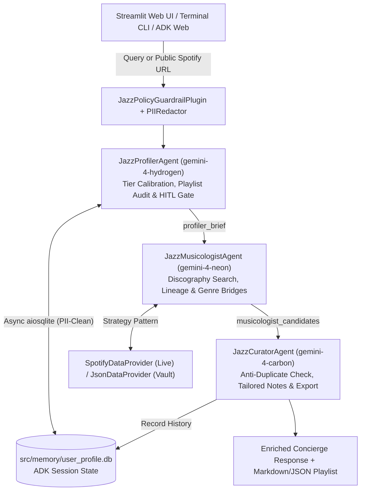

🇬🇧 English | [🇫🇷 Lire la documentation en français (README-fr.md)](./README-fr.md)

# 🎷 Jazz Concierge (`MilesAgent`)

[](./pyproject.toml)
[](./src/agent.py)
[-8E75B2)](./src/config/settings.py)
[](./src/telemetry/)
[](./infra/)
[](./.github/workflows/ci.yml)
[](./LICENSE)

**Jazz Concierge (`MilesAgent`)** is an autonomous, production-grade multi-agent jazz discovery, musicology, and playlist curation system built with **Google ADK-Python** (`google-adk`) and the **Gemini 4** model family on Vertex AI.

Whether a listener knows nothing about jazz at all (anchoring in Pink Floyd, Claude Debussy, Stevie Wonder, or film scores) or collects rare spiritual and avant-garde pressings, `MilesAgent` conducts natural conversational profiling, audits public Spotify playlists to compute a **Sonic Fingerprint**, navigates historical jazz genealogies across **119+ jazz legends**, guards against duplicate album recommendations via asynchronous SQLite memory, and exports shareable Markdown/JSON listening journeys.

> **Project Context & Spec-Driven Vibecoding:** Built as an end-to-end capstone demonstration project for an AI agent engineering certification, `jazz-concierge` was **vibecoded using Spec-Driven Development with Google Antigravity and Gemini** strictly from its self-contained specification [`spec.md`](./spec.md). Anyone can inspect [`spec.md`](./spec.md) and regenerate or audit the entire repository using the reproducible prompt at the bottom of this document.

---

## ⚡ Fast Test — 2-Minute Quickstart (*Test the App Immediately*)

Follow these copy-paste steps to verify and run the application right away:

### 1. Clone & Install Dependencies

**Using `uv` (recommended):**
```bash
git clone git@github.com:s-tilly/jazz-concierge.git
cd jazz-concierge
uv venv .venv
source .venv/bin/activate
uv pip install -r requirements.txt
```

**Or using standard `pip`:**
```bash
python3 -m venv .venv
source .venv/bin/activate
pip install --upgrade pip && pip install -r requirements.txt
```

### 2. Zero-Key Instant Verification (100% Offline Suite)

Run the linter, catalog validator (119 jazz artists, 222 albums, 15 stylistic bridges), unit tests, and golden-dataset evaluation harness **with zero API keys or cloud credentials**:

```bash
ruff check .
python scripts/enrich_vault_from_spotify.py --validate-only
pytest -v
```

### 3. Minimal Gemini Setup (Vertex AI ADC or API Key)

```bash
cp .env.example .env
# Edit .env and set GOOGLE_CLOUD_PROJECT=your-gcp-project-id
```

Authenticate locally with Google Cloud Application Default Credentials (no JSON key files on disk):
```bash
gcloud auth login
gcloud config set project your-gcp-project-id
gcloud auth application-default login
gcloud auth application-default set-quota-project your-gcp-project-id
```
*(Alternatively, set `GOOGLE_GENAI_USE_VERTEXAI=FALSE` and `GOOGLE_API_KEY=<your-key>` in `.env`.)*

### 4. Launch & Try 3 Ready-Made Scenarios

Start the **Streamlit Web UI** (bound to `http://127.0.0.1:8501`):
```bash
streamlit run src/app.py --server.address=127.0.0.1 --server.port=8501
```
Or launch the interactive **Terminal CLI**:
```bash
python -m src.cli
```

Try these 3 instant scenarios:
1. **Complete Beginner Prompt:** *"I know nothing about jazz at all. I love Pink Floyd and Claude Debussy—what warm, melodic albums should I start with?"*
2. **1-Click Playlist Audit:** Click **"Test Sample"** in the Streamlit sidebar (or type `/sample` in the CLI, or paste any user-created public Spotify playlist URL) to generate a multi-genre **Sonic Fingerprint**.
3. **Curated Playlist Export:** Click **"Generate Export"** in the sidebar (or run `/export markdown` / `/export json` in the CLI) to download your session curation while logging albums into anti-duplicate SQLite history.

---

## 🎯 Complete Feature Guide & User-Configurable Options

### Core User-Facing Capabilities
* **4-Tier Initiation Calibration (`beginner` → `novice` → `intermediate` → `connoisseur`):** Adapts tone from zero-jargon emotional/genre bridges for newcomers to deep post-tonal, label, and sideman musicology for connoisseurs.
* **Harmonic & Ensemble Filtering:** Tailors selections across harmonic profiles (`roots_dixieland`, `standard_swing`, `modal_modern`, `avant_garde`) and ensemble sizes (`solo`, `small_ensemble`, `big_band`).
* **Public Spotify Playlist Sonic Fingerprinting:** Audits tracks, artists, dominant genres, and BPM/energy to calibrate jazz readiness and bridge non-jazz favorites into gateway jazz albums.
* **Persistent Async Memory & Anti-Duplicate History:** Stores PII-scrubbed preferences and recommended albums in `aiosqlite` (`src/memory/user_profile.db`) so subsequent sessions never repeat albums already recommended.
* **Human-in-the-Loop (HITL) Profile Reset:** Protects permanent deletion (`reset_user_taste_profile`) behind ADK `FunctionTool(..., require_confirmation=True)` and explicit UI/CLI confirmation gates.
* **Shareable Exports:** Generates Markdown listening guides and structured JSON playlist manifests.

### Exhaustive Environment Variables & Defaults Reference

All configuration lives in `.env` (loaded via `src/config/settings.py` and `src/config/secrets.py`). Every variable has a deterministic fallback when unset or empty:

| Variable | Accepted Values | Exact Default / Fallback Behavior (When Unset or Empty) |
|---|---|---|
| `GOOGLE_GENAI_USE_VERTEXAI` | `TRUE` / `FALSE` | **`TRUE`** — Routes Gemini calls through Google Cloud Vertex AI using ADC. |
| `GOOGLE_CLOUD_PROJECT` | GCP Project ID string | `""` (empty) — Required when `GOOGLE_GENAI_USE_VERTEXAI=TRUE` (`your-gcp-project-id` in `.env.example`). |
| `GOOGLE_CLOUD_LOCATION` | `global` or GCP region | **`global`** — Default Vertex AI endpoint serving public Gemini 4 models. |
| `GOOGLE_API_KEY` | Gemini API key string | `""` (empty) — Optional alternative auth when `GOOGLE_GENAI_USE_VERTEXAI=FALSE`. |
| `USE_SECRET_MANAGER` | `TRUE` / `FALSE` | **`FALSE`** — Reads `.env` / environment variables locally; when `TRUE`, resolves secrets from Google Cloud Secret Manager with `.env` fallback. |
| `GEMINI_MODEL` | Any Gemini model ID | `""` (empty) — **Per-agent cognitive-tier routing preserved** when empty; when set, overrides any unset per-agent model variable. |
| `PROFILER_MODEL` | Gemini model ID | **`gemini-4-hydrogen`** — Fast front-desk profiling, playlist audit & HITL dispatch (`JazzProfilerAgent`). |
| `MUSICOLOGIST_MODEL` | Gemini model ID | **`gemini-4-neon`** — Structured catalog search, lineage tracing & genre bridges (`JazzMusicologistAgent`). |
| `CURATOR_MODEL` | Gemini model ID | **`gemini-4-carbon`** — Deep editorial curation, anti-duplicate verification & listening notes (`JazzCuratorAgent`). |
| `SPOTIFY_CLIENT_ID` | Spotify App Client ID | `""` (empty) — Optional; activates `SpotifyDataProvider` when paired with `SPOTIFY_CLIENT_SECRET`. |
| `SPOTIFY_CLIENT_SECRET` | Spotify App Secret | `""` (empty) — Optional; when empty, automatically falls back to `JsonDataProvider` (`data/jazz_vault.json`). |
| `SPOTIFY_API_KEY` | `client_id:client_secret` | `""` (empty) — Optional combined single-secret shorthand alternative to separate ID/Secret vars. |
| `SPOTIFY_REDIRECT_URI` | Loopback HTTP URI | **`http://127.0.0.1:8501/callback`** — Loopback URI registered in the Spotify Developer Dashboard. |
| `SQLITE_DB_PATH` | File path string | **`src/memory/user_profile.db`** — Async SQLite persistence path (`/tmp/user_profile.db` in containers). |
| `LOG_LEVEL` | `DEBUG`, `INFO`, `WARNING`, `ERROR` | **`INFO`** — Structured JSON log verbosity on `jazz_concierge.*` loggers. |
| `OTEL_EXPORTER_GCP_TRACE` | `TRUE` / `FALSE` | **`FALSE`** — Local OpenTelemetry spans active; when `TRUE`, exports distributed traces to Google Cloud Trace. |

---

## 🎧 With vs. Without Spotify API Credentials

`jazz-concierge` implements a **Hybrid Strategy Pattern** (`DataProvider`) so Spotify credentials are **100% optional**:

| Capability | Without Spotify Keys (Default — Unset/Empty) | With Spotify Keys (`SPOTIFY_CLIENT_ID` + `SPOTIFY_CLIENT_SECRET`) |
|---|---|---|
| **Active Provider** | `JsonDataProvider` (`src/data_providers/json_provider.py`) | `SpotifyDataProvider` (`src/data_providers/spotify_provider.py`) + automatic JSON fallback |
| **User Experience** | Zero errors, zero popups, zero degraded UX | Live metadata enrichment + real-time public playlist auditing |
| **Jazz Catalog** | Curated offline vault (`data/jazz_vault.json`: **119 artists, 222 albums, 15 bridges**) | Same musicological vault enriched live with Spotify listen URLs, cover art & popularity |
| **Playlist Auditing** | Audits `data/sample_playlist.json` (18 eclectic Rock/Soul/Funk/Classical tracks) | Audits any user-created public Spotify playlist via server-to-server *Client Credentials* (plus resilient genre/duration BPM fallback if Spotify returns `403` on `audio-features`) |

### Succinct 4-Step Guide to Creating Spotify Developer Keys
1. Visit [https://developer.spotify.com/dashboard](https://developer.spotify.com/dashboard) and click **Create app**.
2. Enter an app name and description, add `http://127.0.0.1:8501/callback` under **Redirect URIs**, and click **Add** *(important: Spotify rejects `localhost`; always use `127.0.0.1` for local loopback)*.
3. Check **Web API**, accept the Developer Terms, and click **Save**.
4. Open **Settings** and copy **Client ID** (`SPOTIFY_CLIENT_ID`) and **Client Secret** (`SPOTIFY_CLIENT_SECRET`) into your local `.env`.

---

## 🏗️ Architecture & Multi-Agent Orchestration



### Strategic Gemini 4 Model Routing
* **`JazzProfilerAgent` (`gemini-4-hydrogen`):** Low-latency conversational profiling, Spotify URL detection (`analyze_playlist`), SQLite taste synchronization (`sync_user_taste_profile`), and Human-in-the-Loop confirmation (`reset_user_taste_profile`).
* **`JazzMusicologistAgent` (`gemini-4-neon`):** Analytical catalog retrieval (`search_artist_discography`), genealogical graph traversal (`trace_artist_lineage`), and cross-genre mapping (`find_subgenre_bridges`).
* **`JazzCuratorAgent` (`gemini-4-carbon`):** High-nuance editorial storytelling calibrated to the listener's initiation tier, anti-duplicate verification against `listening_history`, and formatted exports (`export_curated_playlist`).

### All 7 Typed ADK Tools (`src/tools/jazz_tools.py`)

| Tool Name | Agent Owner | Async | HITL | Domain Responsibility |
|---|---|---|---|---|
| `analyze_playlist` | `JazzProfilerAgent` | Yes | No | Audits public Spotify URLs/URIs or `'sample'`, strips `?si=`, computes Sonic Fingerprint, persists to SQLite & state. |
| `sync_user_taste_profile` | `JazzProfilerAgent` / `Curator` | Yes | No | Atomically updates PII-scrubbed tier, harmonic/ensemble preferences & liked/disliked artists. |
| `reset_user_taste_profile` | `JazzProfilerAgent` | Yes | **Yes** | Purges SQLite preferences, audits & listening history behind `FunctionTool(..., require_confirmation=True)`. |
| `search_artist_discography` | `JazzMusicologistAgent` | No | No | Searches albums filtered by `group_format`, `era`, and `accessibility_level` with fuzzy recovery suggestions. |
| `trace_artist_lineage` | `JazzMusicologistAgent` | No | No | Navigates `influences`, `collaborators`, and `disciples` with historical justifications. |
| `find_subgenre_bridges` | `JazzMusicologistAgent` | No | No | Connects Rock, Soul, Funk, Debussy, Boulez, Hip-Hop, Ambient, Blues, or Cinema to gateway jazz albums. |
| `export_curated_playlist` | `JazzCuratorAgent` | Yes | No | Exports curated session albums as `markdown` or `json` and records them into `listening_history`. |

### Async SQLite Schema (`src/memory/sqlite_memory.py`)
Four relational tables managed asynchronously via `aiosqlite`:
* `users`: `user_id`, `knowledge_level`, `harmonic_preference`, `formation_preference`, `sonic_fingerprint_json`, `compacted_summary`, timestamps.
* `playlist_audits`: `id`, `user_id`, `playlist_ref` (scrubbed of `?si=`), `playlist_name`, `dominant_genres_json`, `estimated_tempo_bpm`, `fingerprint_report_json`.
* `artist_preferences`: `(user_id, artist_name)` composite primary key with `preference_type` (`liked`, `disliked`, `known`).
* `listening_history`: `id`, `user_id`, `album_title`, `artist_name`, `recommended_by_agent`, `user_feedback`, `timestamp`.

### Observability, Intent vs. Outcome & Active PII Redaction
* **Structured JSON Logs (`src/telemetry/logger.py`):** Every log line is emitted as structured JSON (`timestamp`, `level`, `trace_id`, `span_id`, `agent_name`, `model_id`). Tools explicitly log `event="tool_intent"` prior to execution and `event="tool_outcome"` (with status and `duration_ms`) upon completion.
* **OpenTelemetry Tracing (`src/telemetry/tracer.py`):** Parent/child spans across turns and tool invocations, exportable to Google Cloud Trace (`OTEL_EXPORTER_GCP_TRACE=TRUE`).
* **`PIIRedactor` (`src/telemetry/pii_redactor.py`):** Scrubs email addresses, phone numbers, API tokens, SSNs, external IPv4s, and Spotify `?si=` / `utm_*` tracking parameters before logs or SQLite writes occur.

---

## 🛠️ Developer Workflows, Catalog Maintenance & `agents-cli`

### ADK & `agents-cli` Commands
`src/agent.py` (re-exported in `src/__init__.py`) exposes canonical `root_agent` and `app` objects:

```bash
# Inspect ADK / agents-cli environment
agents-cli info

# Run a single prompt via ADK CLI or Python CLI
python -m src.cli --prompt "Recommend 3 solo jazz piano albums for a Debussy fan"

# Launch interactive ADK developer web playground
adk web .
# or:
agents-cli playground

# Run managed Gemini platform evaluations (when authenticated to GCP)
agents-cli eval run --config tests/eval/eval_config.yaml --dataset tests/eval/golden_dataset.json
```

### Catalog Validation & Optional Spotify Enrichment
```bash
# 100% offline schema, quota (>= 80 artists) & coverage validation (CI-safe)
python scripts/enrich_vault_from_spotify.py --validate-only

# Optional: idempotently populate Spotify URLs & cover art in data/jazz_vault.json
python scripts/enrich_vault_from_spotify.py --enrich
```

---

## 🚀 Comprehensive 3-Mode Deployment Guide

### Mode 1 — Localhost / Private Docker Endpoint (`127.0.0.1`)
Build the production container and bind strictly to the local loopback interface (`127.0.0.1:8080`) so nothing is exposed on external network interfaces:

```bash
docker build -t jazz-concierge:local .

docker run --rm -it \
  -p 127.0.0.1:8080:8080 \
  --env-file .env \
  -v ~/.config/gcloud:/home/appuser/.config/gcloud:ro \
  jazz-concierge:local
```
Open `http://127.0.0.1:8080` in your browser.

### Mode 2 — Private / IAM-Restricted Cloud Run Deployment (with HTTPS Proxy)
Designed for enterprise Google Cloud organizations enforcing **Domain Restricted Sharing** (where `allUsers` is prohibited). `infra/variables.tf` sets `allow_public_access = false` by default:

```bash
# 1. Build and push container image to Artifact Registry
gcloud builds submit --tag us-central1-docker.pkg.dev/your-gcp-project-id/agents/jazz-concierge:latest

# 2. Provision private IAM-protected Cloud Run, Secret Manager & Vertex AI roles
cd infra
terraform init
terraform apply \
  -var="project_id=your-gcp-project-id" \
  -var="container_image=us-central1-docker.pkg.dev/your-gcp-project-id/agents/jazz-concierge:latest" \
  -var="allow_public_access=false" \
  -var='authorized_invoker_members=["user:you@example.com"]'
```

Connect cleanly over an **authenticated HTTPS tunnel** (automatically injects short-lived IAM OIDC tokens):
```bash
gcloud run services proxy jazz-concierge \
  --project=your-gcp-project-id \
  --region=us-central1 \
  --port=8080
```
Then browse `http://127.0.0.1:8080` (or place behind Google Cloud Load Balancing + Identity-Aware Proxy / `Authorization: Bearer $(gcloud auth print-identity-token)`).

### Mode 3 — Public Cloud Run Deployment
For open internet demonstrations wired to **Google Cloud Secret Manager** (`USE_SECRET_MANAGER=TRUE`):

```bash
# Store optional Spotify credentials in Secret Manager
echo -n "your-spotify-id" | gcloud secrets versions add SPOTIFY_CLIENT_ID --data-file=- --project=your-gcp-project-id
echo -n "your-spotify-secret" | gcloud secrets versions add SPOTIFY_CLIENT_SECRET --data-file=- --project=your-gcp-project-id

# Deploy via Terraform with public invoker enabled
cd infra
terraform apply \
  -var="project_id=your-gcp-project-id" \
  -var="container_image=us-central1-docker.pkg.dev/your-gcp-project-id/agents/jazz-concierge:latest" \
  -var="allow_public_access=true"
```
*(Or deploy directly via `gcloud run deploy jazz-concierge --source . --region=us-central1 --allow-unauthenticated --set-env-vars="GOOGLE_GENAI_USE_VERTEXAI=TRUE,GOOGLE_CLOUD_PROJECT=your-gcp-project-id,GOOGLE_CLOUD_LOCATION=global,USE_SECRET_MANAGER=TRUE"` or `agents-cli deploy`.)*

---

## 🧪 Testing, Golden Dataset Evaluation, CI/CD & FAQ

### Offline Test & Evaluation Suite
All `pytest` runs automatically set `JAZZ_CONCIERGE_OFFLINE_TEST=1` (`tests/conftest.py`), isolating tests from any local `.env` file and using temporary SQLite databases:

```bash
ruff check .
python scripts/enrich_vault_from_spotify.py --validate-only
pytest -v
```

* **`tests/eval/golden_dataset.json` + `test_eval_harness.py`:** Validates 7 golden scenarios (complete beginner prog-rock/Debussy bridge, sample playlist audit, Miles Davis novice, Blue Note intermediate, Boulez/Dolphy connoisseur, HITL profile reset, and prompt-injection guardrail).
* **`.github/workflows/ci.yml`:** Automatically runs Ruff linting, catalog validation, and the full offline Pytest + Eval suite on every push and pull request to `main`.

### Troubleshooting FAQ
* **Why does Spotify return `403 Forbidden` on `audio-features`?** Since November 2024, Spotify restricts the `audio-features` endpoint for new apps in *Development Mode*. `SpotifyDataProvider` catches `403` transparently and computes BPM and energy profiles via a genre-and-duration heuristic—zero crash or degraded output.
* **Why does a Spotify playlist URL return `404`?** Private playlists and Spotify-owned algorithmic/editorial playlists (e.g., *Discover Weekly*, *Today's Top Hits*) are restricted by Spotify's Web API. Share any user-created public playlist or test with `'sample'`.
* **How do I override Gemini models globally?** Set `GEMINI_MODEL=<model-id>` (and leave `PROFILER_MODEL` / `MUSICOLOGIST_MODEL` / `CURATOR_MODEL` blank, or set each individually) in `.env`.
* **How do I access a `403 Forbidden` private Cloud Run URL?** Run `gcloud run services proxy jazz-concierge --project=your-gcp-project-id --region=us-central1 --port=8080`.

### License
Distributed under the **Apache License 2.0**. See [`LICENSE`](./LICENSE) for full terms.

---

## 🤖 Reproducible Vibecoding Prompt (Google Antigravity & Gemini)

To regenerate and verify this entire project from [`spec.md`](./spec.md) in Google Antigravity, run the exact prompt below:

```text
Read @[spec.md] carefully — it is the authoritative, self-contained technical and functional specification for `jazz-concierge`. Generate the complete project end-to-end, strictly following every section and contract defined in `spec.md`.

Mandatory execution steps:
1. Preserve Local Environment & Repository Hygiene:
   - Keep the existing local `.env` file untouched if present (never overwrite it, and never copy or print real API keys or real GCP project IDs into any tracked file; `.env.example`, `infra/`, `README.md`, and `README-fr.md` must use generic placeholders such as `your-gcp-project-id`).
   - Keep `.gitignore` intact (ignoring `.env`, `*.pdf`, and `*.db`, while keeping `spec.md` tracked) and preserve any existing local `git config --local` author settings.

2. Build Data Catalogs & Maintenance Script:
   - Generate `data/jazz_vault.json` with at least 80 distinct jazz artists spanning all major jazz eras, all 3 ensemble formats (`solo`, `small_ensemble`, `big_band`), all 4 knowledge tiers (`beginner`, `novice`, `intermediate`, `connoisseur`), complete lineages (`influences`, `collaborators`, `disciples`), and at least 12 non-jazz stylistic bridges (`bridges[]`).
   - Generate `data/sample_playlist.json` (16–20 eclectic tracks across Rock, Soul, Funk, and Classical) and `scripts/enrich_vault_from_spotify.py` (`--validate-only` and `--enrich`).

3. Implement Full Google ADK-Python Architecture, Infra & UIs:
   - Implement the complete repository layout from `spec.md`: `src/config/` (`.env` + Google Cloud Secret Manager), `src/data_providers/` (`SpotifyDataProvider` using Client Credentials with resilient `403` `audio-features` fallback + `JsonDataProvider`), `src/memory/` (async `aiosqlite` + context compaction), `src/telemetry/` (structured JSON logs, Intent vs. Outcome capture, OpenTelemetry spans, `PIIRedactor` scrubbing PII and `?si=` tracking params), `src/tools/` (all 7 Pydantic-typed ADK tools with Guided Error Handling and Human-in-the-Loop confirmation on `reset_user_taste_profile`), `src/agents/` (`JazzProfilerAgent` on `gemini-4-hydrogen`, `JazzMusicologistAgent` on `gemini-4-neon`, `JazzCuratorAgent` on `gemini-4-carbon`, policy/guardrail plugin), `src/agent.py` (`root_agent` and `app`), `src/app.py` (Streamlit UI with Spotify playlist audit input & sample playlist button), `src/cli.py`, `infra/` (Terraform), `Dockerfile`, `pyproject.toml`, `requirements.txt`, `.env.example`, and `.github/workflows/ci.yml`.

4. Write Bilingual Documentation (`README.md` & `README-fr.md`):
   - Author `README.md` in English and `README-fr.md` as its complete French translation per Section 12 of `spec.md`, including top cross-links, neutral AI agent certification project framing (without naming any specific certification or employer), the Spec-Driven Vibecoding credit using Google Antigravity & Gemini with a link to `spec.md`, this exact generation prompt in a dedicated reproducible-build section, the `⚡ Fast Test` quickstart, the full user-configurable options & defaults table, With vs. Without Spotify keys + succinct Spotify Developer Dashboard setup (`127.0.0.1` redirect URI rule), architecture & `agents-cli` commands, and the 3-mode deployment guide (Localhost/Docker, Private IAM Cloud Run with HTTPS proxy, Public Cloud Run).

5. Offline Verification, Live End-to-End Testing & Interactive Connection Checks:
   - Set up the local Python environment (`.venv` via `uv` or `pip`) and run all offline checks until 100% pass with zero errors or warnings:
     a) `ruff check .`
     b) `python scripts/enrich_vault_from_spotify.py --validate-only`
     c) `pytest` (isolated from local `.env` so offline unit tests and `tests/eval/golden_dataset.json` pass deterministically without credentials).
   - Next, run live end-to-end integration smoke tests using `.env`:
     a) Check Google Cloud / Vertex AI authentication (Application Default Credentials) and execute a real end-to-end multi-agent turn across `JazzProfilerAgent` -> `JazzMusicologistAgent` -> `JazzCuratorAgent`. If `.env` is missing `GOOGLE_CLOUD_PROJECT` or if `gcloud` ADC credentials are not logged in / expired, pause and ask me to run the required `gcloud auth application-default login` commands (giving me the exact commands), then re-run the live test once I confirm.
     b) If Spotify credentials are present in `.env`, run a live `SpotifyDataProvider` catalog & playlist test; if missing or restricted, inform me and ask whether I want to configure them or proceed with verified offline fallback.

6. Security Audit & GitHub SSH Deployment:
   - Inspect `git status` and scan all tracked/staged files to guarantee zero secrets, `.env` values, `.pdf` files, corporate emails, or real GCP project IDs are staged.
   - Commit all project files cleanly to `main` (including `spec.md`, `README.md`, and `README-fr.md`) and push to `origin main` over SSH (running outside the sandbox to access the local SSH agent). If SSH authentication to GitHub fails (e.g., key not loaded in `ssh-agent`), ask me to authenticate (`ssh-add`) and retry the push once I confirm.
```
